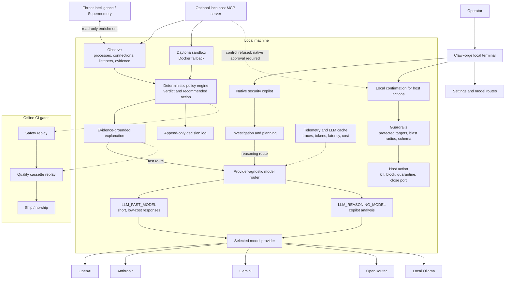

# ClawForge

### AI security harness for your machine.


ClawForge is a local terminal application for observing network activity, investigating suspicious processes, sandboxing code, and taking guarded security actions. It has no TrueForge dependency and does not require Node.js or a hosted orchestration service.

It includes a native copilot, local human approvals, provider-agnostic model routing, telemetry, offline evaluation gates, and an optional localhost MCP server for compatible clients.

## What it does

- Observe processes, connections, listeners, evidence, and threat intelligence.
- Explain deterministic security verdicts with an LLM without allowing the LLM to change them.
- Run untrusted code in a Daytona sandbox, with Docker as a fallback.
- Require a local human confirmation before any host-changing action.
- Expose observe and sandbox operations to external MCP clients on localhost.

## Architecture



The model never determines a security verdict or bypasses a guardrail. The deterministic policy engine decides; the model only explains or investigates within that boundary.

## Quickstart

Requires Windows, Python 3.10+, an LLM API key or local Ollama, and a sandbox: Daytona (`DAYTONA_API_KEY`) and/or Docker Desktop.

```powershell
python -m venv .venv
.venv\Scripts\activate
pip install -r core/requirements.txt
copy .env.example .env

# Start the standalone local copilot.
python -m clawforge
```

Or use the launcher:

```powershell
.\start.ps1
```

Start the optional local MCP server only when another MCP client needs ClawForge tools:

```powershell
python -m clawforge serve
```

## Model routing

Choose one provider and two model IDs. The names are provider-specific, so this works with OpenAI, Anthropic, Gemini, OpenRouter, or Ollama.

```powershell
python -m clawforge settings set LLM_PROVIDER gemini
python -m clawforge settings route fast gemini-3.6-flash
python -m clawforge settings route reasoning your-larger-reasoning-model
```

`fast` is used for short connection and sandbox explanations. `reasoning` is used by the local security copilot. Settings are saved to `.env`; API keys are intentionally not accepted through the settings UI.

## Safety model

| Tier | Capability | Gate |
|---|---|---|
| Observe | process, connection, evidence, and threat-intel inspection | read-only |
| Execute | sandbox code, paths, and repositories | isolated Daytona or Docker environment |
| Control | kill, suspend, block, quarantine, close port, promote sandbox result | native local confirmation and guardrails |

Run a control action through the native terminal:

```powershell
python -m clawforge action kill_process 1234 "Critical outbound beaconing from a Temp binary"
```

The command displays the exact action, target, and reason before asking for confirmation. Guardrails then run again and may still refuse protected processes, private IPs, system files, or failed chain-of-trust checks.

The optional MCP server remains localhost-only and bearer-authenticated. It supports observe and sandbox tools; it refuses control calls because remote clients cannot bypass the native local approval boundary.

## Commands

| Command | Purpose |
|---|---|
| `python -m clawforge` | open the local copilot |
| `python -m clawforge status` | print local machine and sandbox status |
| `python -m clawforge settings` | show model, routing, telemetry, and cache settings |
| `python -m clawforge settings route fast MODEL` | set the small/fast model |
| `python -m clawforge settings route reasoning MODEL` | set the deeper analysis model |
| `python -m clawforge serve` | start the optional localhost MCP server |
| `python -m clawforge tools` | list exposed MCP tools and tiers |
| `python -m clawforge action ...` | propose and locally approve a host-changing action |

## Repository layout

- `core/` — policy engine, monitor, sandbox, guardrails, LLM adapter, quality gates.
- `clawforge/` — standalone terminal commands, settings dashboard, capabilities, optional MCP server, and RBAC.
- `tests/` — deterministic policy, guardrail, LLM, RBAC, telemetry, and quality tests.
- `scripts/` — local launcher and optional service scripts.

ClawForge is a self-contained security harness: the terminal owns the copilot, approvals, settings, and routing; ClawNet provides the deterministic security controls underneath.
